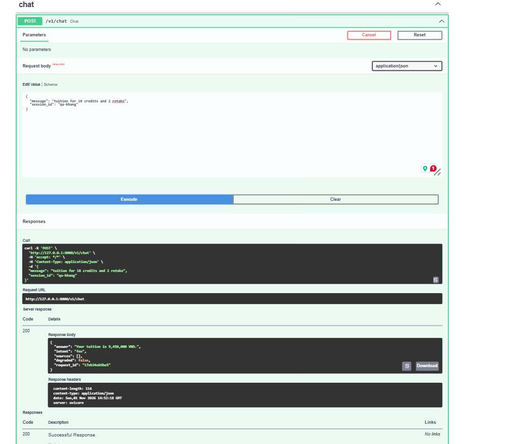

# Lab 4 — Part E: QA/QC Report

**Student:** Nguyen Minh Khang  
**Student ID:** 25125018  
**GitHub:** @KaKaAkagami  
**Role:** Part E — QA/QC  
**Initial QA:** 2026-11-01
**Final re-check:** 2026-11-06

## 1. Scope

This report documents the initial QA/QC results for the Lab 4 REST API project.

Repository: https://github.com/khanhf-ng820/assistant_core_lab

The initial API checks were performed against the team foundation and T1 Chat API at commit `f2ea073`, before final integration of all team features.

## 2. Automated Testing

### Warm-up P1–P5

Command:

```bash
python -m pytest -q lab04/practice/test_hello_api.py
```

Result: **5 passed**

Ruff: **All checks passed**

### T1 Chat API and Foundation

Command:

```bash
python -m pytest -q tests/api/test_chat.py tests/api/test_api_foundation.py
```

Result: **26 passed**

### Full Regression Suite

Command:

```bash
python -m pytest -q
```

Result:

- 193 passed
- 4 skipped
- 0 failed
- 1 deprecation warning

The four skipped tests were already present in the existing test suite.

### Static Analysis

Command:

```bash
python -m ruff check .
```

Result: **All checks passed**

### Final Integration Re-check (2026-11-06)

Re-checked at commit `f1cc905` after T3, Part F, T4 and H1 merged.

Commands:

```bash
.venv/bin/python -m pytest -q
.venv/bin/ruff check .
.venv/bin/ruff format --check .
.venv/bin/python scripts/check_week3_tests.py
```

Results:

- Root suite: **218 passed, 4 skipped, 0 failed**
- Ruff lint and format: **clean**
- Week 3 tests: **14/14 unchanged**
- Warm-up: **5 passed**
- Root curl smoke: five working endpoints passed; T2 omitted
  ([transcript](curl_transcript.md))

The green suite does not include a successful `POST /v1/feedback` test, so it does not
prove that T2 works.

## 3. Manual API Testing

Base URL: `http://127.0.0.1:8000`

| Method | Endpoint | Test Case | Expected | Actual | Result |
|---|---|---|---|---|---|
| GET | `/health` | Health check | 200 | 200 | PASS |
| POST | `/v1/chat` | Valid tuition question | 200 | 200 | PASS |
| POST | `/v1/chat` | Empty message | 422 | 422 | PASS |
| GET | `/v1/feedback` | Missing API key | 401 | 401 | PASS |

### Chat API Response

Request:

```json
{
  "message": "tuition for 18 credits and 2 retake",
  "session_id": "qa-khang"
}
```

Observed response:

```json
{
  "answer": "Your tuition is 9,450,000 VND.",
  "intent": "fee",
  "sources": [],
  "degraded": false,
  "request_id": "0c6439b4e4ab"
}
```

HTTP status: **200 OK**

### Invalid Chat Request

Request:

```json
{
  "message": ""
}
```

Observed response:

```json
{
  "error": {
    "code": "invalid_request",
    "message": "message: String should have at least 1 character"
  }
}
```

HTTP status: **422**

### Unauthorized Admin Request

Endpoint: `GET /v1/feedback`

Observed response:

```json
{
  "error": {
    "code": "missing_or_invalid_api_key",
    "message": "Missing or invalid API key"
  }
}
```

HTTP status: **401 Unauthorized**

### Health Check

Observed response:

```json
{
  "status": "ok",
  "version": "1.0.0"
}
```

HTTP status: **200 OK**

## 4. Swagger UI Verification

Swagger UI URL: `http://127.0.0.1:8000/docs`

Verified:

- OpenAPI documentation loads successfully.
- POST `/v1/chat` accepts a valid JSON request.
- The response has HTTP status 200.
- The response includes `answer`, `intent`, `sources`, `degraded`, and `request_id`.

A screenshot of the successful chat request was captured during manual testing.

### Swagger Evidence



The screenshot shows a successful POST /v1/chat request with HTTP 200 and the expected tuition response.

## 5. Cross-Review

Reviewed PR #21 — T1 Chat API.

URL: https://github.com/khanhf-ng820/assistant_core_lab/pull/21

Review status: **Approved**

The implementation and tests were checked for:

- Correct integration with `service.handle()`.
- Proper message and session ID propagation.
- Unique 12-character request IDs.
- Correct response schema.
- Input validation and HTTP 422.
- Preservation of Lab 3 behavior.

CI passed on Python 3.10 and 3.12.

## 6. Pending Integration Checks

The following requirements must be validated against the final integrated API:

| Feature | Required Check | Status |
|---|---|---|
| T2 Feedback POST | HTTP 201, sequential ID, UTC timestamp | **FAIL** — valid POST returns HTTP 500; root handler is still a TODO |
| T3 Admin Feedback | Authorized access with valid key | PASS |
| Part F Rate Limiting | HTTP 429 after exceeding request limit | PASS |
| T4 Weather API | HTTP 200, fallback, HTTP 503 | PASS |
| H1 Offices API | HTTP 200, Library present, sorted offices | PASS |
| Full Team Integration | Complete test suite and CI | **PARTIAL** — full root suite is green; T2 success path is not covered |

The earlier PASS results applied to commit `f2ea073` only. The 2026-11-06 re-check
extends the PASS results to `f1cc905` for T3, Part F, T4 and H1, but T2 still fails.

## 7. Conclusion

The API foundation, T1 Chat API, T3 admin feedback, Part F rate limiting, T4 weather and
H1 offices passed automated and live checks at `f1cc905`.

T2 `POST /v1/feedback` remains unimplemented in the root API: valid requests return
HTTP 500, so the final integrated submission is **not yet complete**. The `v0.4-api` tag
must wait for T2 and the final evidence refresh.
