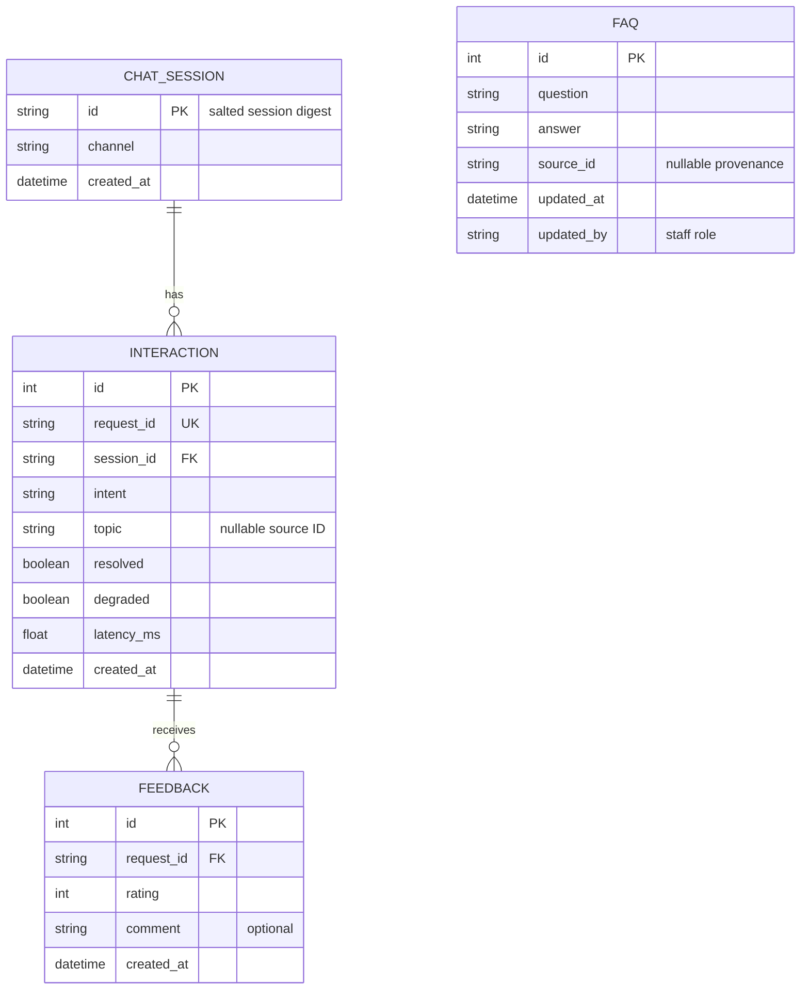

# Lab 5 — H3: Data model and security design review

**Owner:** Trần Phúc Khánh (25125020), @TranPhucKhanhh
**Reviewer:** Đặng Xuân Phát, @Dang-Xuan-Phat
**Branch:** `docs/bonus-design-review` · **Issue:** [#38](https://github.com/khanhf-ng820/assistant_core_lab/issues/38)
**Reviewed baseline:** `fd398ca` · **Date:** 8 November 2026

This is the assigned H3 documentation review of [the bad schema](../../sql/bad_schema.sql),
following [the Lab 5 worksheet](../../lab05/worksheets/data_model.md).
It proposes corrections and storage decisions; it does not implement migrations,
R1/R2, query exercises, seeding, API integration, or retention jobs.

## 1. Critique of bad_schema.sql

The purpose is to measure the assistant's usage, failures and performance, and
collect feedback. Identifying students or archiving conversations is unnecessary
for those questions.

| # | Problem in the supplied schema | Impact | Proposed correction |
|---|---|---|---|
| 1 | `id INTEGER` has no primary key, uniqueness or required-value constraint. | Duplicate and missing IDs prevent reliable updates and references. | Use `INTEGER PRIMARY KEY`; give each interaction a unique, required `request_id` for feedback correlation. |
| 2 | `student_name` and `student_phone` are copied into every chat. | Unnecessary direct identifiers increase disclosure risk and duplication. | Omit both from analytics; do not replace them with hashes of names/phone numbers. |
| 3 | Full `message` is retained indefinitely. | Students can include contact details, student IDs or sensitive circumstances. A database leak exposes the original text. | Process the message transiently; persist intent, approved topic ID, outcome and latency instead. |
| 4 | Full `answer` is stored without a purpose or retention limit. | Answers may repeat information from the prompt and duplicate reference content. | Omit raw answers; use a source/topic ID where needed, with a separately curated FAQ for reusable public answers. |
| 5 | `intent` is uncontrolled free text. | `fee`, `Fee` and `tuition` split one category and distort reports. | Use the root `Intent` vocabulary: greeting, fee, office, rule, help, unknown; validate at write boundaries and consider a DB CHECK. |
| 6 | `time TEXT` uses a locale-dependent format without a timezone. | Lexical ordering and date filtering need not follow chronology. | Use a required UTC timestamp with one consistent representation; index interaction time. SQLite can store valid ISO timestamps as text. |
| 7 | `feedback TEXT` is a comma-separated list with no range validation. | Individual ratings have no IDs/timestamps, cannot be constrained, and are difficult to query or update safely. | Create one Feedback row per rating, with its own key, timestamp, `CHECK (rating IN (-1,0,1))` and optional bounded comment. |
| 8 | No session entity or feedback-to-interaction relationship exists. | Session analysis and attribution of feedback are unreliable. | Separate ChatSession, Interaction and Feedback; link them with foreign keys and enable enforcement. Never use a student identifier as the session key. |
| 9 | `latency TEXT` stores units inside the value. | Numeric aggregation can silently misread mixed units or non-numeric strings. | Persist finite, non-negative numeric milliseconds in `latency_ms`; label units in the API/report. |
| 10 | No `topic`, `resolved` or `degraded` fields describe the outcome. | Usage cannot distinguish an unknown answer, a fallback or a repeatedly unresolved topic. | Add structured outcome flags and an optional approved topic/source ID. Unknown intent is unresolved; a provider fallback is degraded, not automatically unresolved. |
| 11 | No intent/time lookup indexes are defined. | Reports scan increasingly large chat tables. | Index interaction intent/time/session and feedback request ID as in the starter migration; assess query plans before adding more. |
| 12 | The design has no retention/deletion policy. | Indefinite accumulation increases exposure; deleting a single identifying column does not remove PII elsewhere. | Set and implement explicit retention for comments and metadata, including backups and dependent rows; see section 2. |

SQL injection is not established merely by these column definitions. Prevent it
at query boundaries with bound parameters/SQLModel expressions, rather than
claiming that changing a column type sanitizes input. A schema also cannot
enforce who may read the SQLite file or prevent unsafe rendering of comments.

## 2. Store or not? Privacy-aware storage

The following periods are **proposed team defaults**, not existing automated
behaviour or claims about a legally required retention period. Confirm them
before collecting real data.

| Data | Store? | Form | Proposed retention | Reason / restriction |
|---|---|---|---|---|
| Raw user message | No | None in DB, logs, screenshots or exports | Request lifetime only | Metadata answers the product questions without retaining conversational PII. |
| Raw assistant answer | No | None in analytics DB | Request lifetime only | May repeat user text; curated public FAQs are separate content. |
| Session ID | Yes, for limited correlation | Salted pseudonymous digest; never the raw client value | 90 days, remove sessions without retained interactions | Count/group sessions without storing names or phone numbers; it is still linkable metadata. |
| Intent, latency, topic, outcome, request ID, timestamp | Yes | Structured metadata; topic is an approved rule/source ID | 90 days | Supports performance and unresolved-topic analysis; never place free-text questions in topic. |
| Feedback rating | Yes | Integer -1, 0 or 1 linked to request ID | 90 days | Quantifies feedback; preserve separate ratings rather than a comma-separated list. |
| Feedback comment | Optional | Short text; warn users not to include personal details, redact/review before export | At most 30 days; clear earlier if it contains unnecessary PII | Free text can reintroduce names, numbers or sensitive details even when messages are omitted. A length limit alone does not remove PII. |
| Student name / phone / student ID | No | None, including hashes of these identifiers | Not collected for analytics | Not needed for any worksheet product question. |
| API keys and SESSION_SALT | No in tables or Git | Deployment configuration; placeholders only in examples | Follow credential rotation policy | Keep separately from data/backups; never copy them into reports or error responses. |
| Long-term trends | Only if needed | Coarse aggregates without request/session IDs or comments | Up to 12 months after team approval | Drop/suppress very small groups and avoid publishing identifiable topic/time combinations. |

The existing `hash_session` in [db.py](../../src/assistant_api/db.py) stores the
first 16 hex characters of SHA-256(salt + raw session ID). This is a deterministic,
64-bit truncated pseudonym, **not encryption, guaranteed uniqueness, or anonymity**.
The same salt preserves correlation across restarts; a known salt and guessable
raw IDs permit enumeration. Keep a non-placeholder deployment salt outside Git,
avoid raw identifiers in logs, and plan key rotation/deletion together. A keyed
HMAC with a longer digest is a possible future improvement, not an implemented
requirement of this documentation PR. A supplied session ID is not authentication.

Before production use, a scheduled cleanup must clear expired comments, delete
dependent feedback before expired interactions, and remove unused sessions in
a transaction. Backups need an expiry policy too; restoring one must not
silently undo deletions. Retention is not implemented by having a created_at field.

Restrict SQLite file/backup access to the service and authorised operators.
Protect admin reads, use HTTPS outside local testing, limit exported columns,
and render comments as untrusted text. These are deployment/integration actions,
not guarantees provided by the table definitions. Use synthetic seed data only;
do not commit operational databases, real comments, screenshots with PII, or keys.

## 3. Product questions → fields

These are query sketches for the worksheet; the executable F1–F3/H2 exercises
remain with their assigned owners in `sql/my_queries.sql`.

| Product question | Fields needed | Tables | Query sketch / interpretation |
|---|---|---|---|
| Most failed intent? | intent, resolved | Interaction | GROUP BY intent; count unresolved rows with SUM(CASE WHEN resolved = 0 THEN 1 ELSE 0 END). Show total requests and unresolved rate alongside count. |
| Average response time by intent? | intent, latency_ms | Interaction | GROUP BY intent; AVG(latency_ms), using only valid numeric milliseconds. |
| Top unresolved topics? | topic, resolved | Interaction | WHERE resolved = 0 AND topic IS NOT NULL; GROUP BY topic; order by COUNT(*) DESC. Report unclassified NULL topics separately. |

Unresolved responses and negative feedback measure different things. For negative
feedback by topic, join Feedback to Interaction on request_id and filter rating = -1.
Counting joined rows counts **ratings**, not unique failed interactions: several
feedback rows may reference one interaction. Decide which metric is intended
before using COUNT(*) or COUNT(DISTINCT interaction.request_id).
Do not group by comments, names or phone numbers.

## 4. Entities, keys and relationships

The diagram matches the declared Lab 5 entities. It is a target relationship
contract, not evidence that SQLite foreign keys are enabled on every connection.

A session can have zero or many interactions, and an interaction can receive zero
or many feedback records. Feedback.request_id references the unique
Interaction.request_id, not its numeric ID. The FAQ introduced by migration 002
holds staff-curated public content; source_id is a provenance string, not a
declared foreign key to another SQL table. Do not add student conversation text
to FAQ as a substitute for storing raw messages.

## 5. Existing safeguards versus remaining work

Evidence: [migration 001](../../sql/migrations/001_init.sql),
[migration 002](../../sql/migrations/002_add_faq.sql),
[root repository models](../../src/assistant_api/db.py),
[API schemas](../../src/assistant_api/schemas.py) and
[root API factory](../../src/assistant_api/main.py), at baseline fd398ca.

| Area | Present in the repository | Remaining recommendation / integration boundary |
|---|---|---|
| Data minimisation | Lab 5 models omit raw messages, answers and direct student identifiers; sessions are hashed. | Enforce the same policy in logging, comments, evidence and exports; hashed sessions remain pseudonymous. |
| Keys and rating constraints | Migration 001 declares primary/foreign keys, unique request IDs and the rating CHECK. | SQLite FK enforcement must be explicitly enabled/verified for each connection; make_engine and migrate.py currently do not do so. |
| Schema creation paths | migrate.py runs SQL files; init_db calls SQLModel.metadata.create_all. | The ORM-created feedback table currently lacks the migration's rating CHECK. Align schema paths before claiming identical DB-level validation. |
| Value bounds | FeedbackIn validates rating and comment length at the API boundary. | SQLite VARCHAR(500) does not itself enforce 500 characters. Consider CHECK(length(comment) <= 500), controlled intent values and finite/non-negative latency validation for all writers. |
| Time | Models create UTC datetimes. | Use a consistent UTC serialization contract when persisting/reloading; TIMESTAMP's name alone does not validate locale strings/timezones in SQLite. |
| Persistence | SQLModel repository and migrate/seed helpers exist. | On main, R1/R2 are TODOs; the root API still uses an in-memory feedback list and does not record interactions. Database-reopen tests alone do not prove HTTP restart persistence. |
| Access and retention | Root admin feedback GET requires X-API-Key. | File permissions, cleanup, backup expiry and export controls require separate operational work; no claim they are already deployed. |

SQLite documents [per-connection foreign key enforcement](https://www.sqlite.org/foreignkeys.html#fk_enable)
and [type affinity, date representation and ignored VARCHAR length](https://www.sqlite.org/datatype3.html).
These qualifications matter when comparing declared fields with actual constraints.

## 6. Verification evidence

Disposable in-memory checks on 8 November 2026 reproduced the following without
reading or writing a real student database:

- The bad schema accepted two rows with id 7, a NULL ID, and feedback `8,nope`.
- AVG(latency) over `120ms` and `1s` returned 60.5, instead of the 560 ms mean
  after correct conversion. The mixed units are not validated.
- With migration 001 and foreign_keys explicitly ON, unknown feedback request IDs
  and rating 5 were rejected. The same schema accepted a 501-character comment,
  an uncontrolled `FEE` intent and a negative latency.
- A fresh SQLite connection and the current ORM make_engine connection reported
  foreign_keys = 0. The ORM-created feedback table contained no rating CHECK.

The review deliberately leaves the bad example, migrations, application code and
existing tests unchanged. Runtime/constraint improvements above are follow-up
recommendations, not fixes claimed by this documentation submission.

AI assistance: OpenAI Codex drafted the review and ran the disposable checks.
The author and assigned reviewer still need to inspect the document; see the
[AI-use log](../ai-use-log.md).
